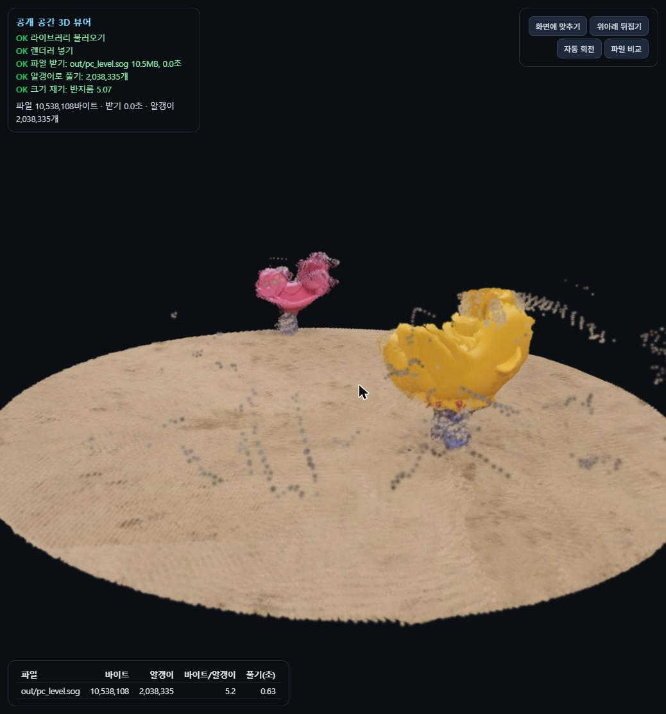

# 공개 가능한 공간의 3D 뷰어

- 보기: (Pages 주소, 공개 후 채움)
- 화면: 

폰으로 찍은 영상에서 MapAnything으로 점과 카메라 위치를 얻고, 점을 가우시안 스플랫으로 바꿔 웹에 올렸습니다.

## 1. 고른 공간과 공개 판단
<!-- 직접 작성: 어디를 골랐고, 왜 남에게 보내도 되는지 한 줄 이상. 촬영 정책 확인, 얼굴·문패·차량 번호를 어떻게 피했는지 -->

## 2. 촬영
| 항목 | 값 |
|---|---|
| 촬영한 부분 | |
| 걸은 경로 | |
| 영상 길이 · 해상도 | 19.1초 · 1920×1080 가로 · 30fps |
| 추출한 프레임 수 | 24 (영상 전체에서 고르게, 흐린 장 없음) |

## 3. 복원 결과 (MapAnything `facebook/map-anything-apache`, fp16)
| 항목 | 값 |
|---|---|
| 모델 입력 크기 | 518×294 (원본 1920×1080이 이 크기로 줄어 들어감) |
| 점 개수 | 3,552,067 → 각 축 0.5% 밖 제거 후 3,474,972 |
| 카메라 퍼짐 비 (카메라 상자 대각선 ÷ 장면 상자 대각선) | 0.73 |
| 카메라 이동 경로 길이(추정) | 15.36m |
| 실제 촬영 경로와 비교 | <!-- 직접 작성 --> |
| 배경 제거 | 기구 주변 수평 반경 3.2m, 바닥 기준 -0.3~1.3m 밖 점 제거 → 2,038,335개. 바닥이 수평이 되게 회전 |
| 알갱이 반지름 | K = 1.4 → 0.0076m (장면 긴 변 7.72m, √N 기준) |

### 같은 사진 24장으로 PC와 코랩 비교
| 항목 | PC (RTX 3070 8GB, Windows) | 코랩 (T4 16GB, Linux) |
|---|---|---|
| 모델 준비 (4.9GB 내려받기 포함, 첫 실행) | 111.5초 | 244.4초 |
| 복원 계산 | 11.41초 | 10.85초 |
| 최대 GPU 메모리 | 6.74GB | 6.74GB |
| 점 개수 (제거 후) | 3,474,972 | 3,475,036 |
| 카메라 퍼짐 비 | 0.7301 | 0.73 |

- 두 결과의 카메라 위치 차이는 평균 0.9mm(최대 1.8mm), 두 점구름 사이 평균 거리 18.6mm로 점 간격(15.3mm)과 비슷하다. 같은 입력이면 결과는 사실상 같고, 차이는 준비 시간이다.
- 공개 결과는 원본 영상을 외부에 올리지 않은 PC 결과를 썼다.

## 4. 형식별 비교 (splat-transform 3.10.3)
| 형식 | 크기(바이트) | 변환 시간 | 알갱이 수 | 알갱이당 바이트 |
|---|---|---|---|---|
| 원본 `.ply` (배경 제거 후) | 138,607,197 | 0.8초(파이썬 저장) | 2,038,335 | 68.0 |
| `.compressed.ply` | 33,187,357 | 3.1초 | 2,038,335 | 16.3 |
| `.sog` | 10,538,108 | 3.1초 | 2,038,335 | 5.2 |
| `.spz` | 13,704,748 | 4.1초 | 2,038,335 | 6.7 |

세 형식 모두 뷰어에서 열렸고 알갱이 수가 같다. (배경 제거 전 전체 장면 3,474,972개는 `.ply` 236MB로 GitHub 100MiB 한도를 넘는다)

고른 형식과 이유: <!-- 직접 작성: 크기만이 아니라 열리는지, 모서리·작은 물건이 어떻게 보이는지 -->

## 5. 첫 화면까지 걸린 시간
| 기기 | 통신 환경 | 처음 받기 / 다시 열기 | 첫 화면까지 |
|---|---|---|---|
| 내 폰 | | | |
| 다른 사람 폰 | | | |

## 6. 잘 보이는 곳과 안 나온 곳
<!-- 직접 작성: 잘 보이는 방향, 구멍·잡티·검은 얼룩이 드러나는 방향, 원본 영상에서 확인한 이유(안 찍힌 면 / 시차 부족 / 반사·움직임 / 알갱이 크기)를 시차·정렬과 연결해서 -->

## 7. 회고
<!-- 직접 작성 -->

## 파일
| 파일 | 내용 |
|---|---|
| `index.html` | three.js 0.180.0 + Spark 2.4.0 뷰어. 진행 단계·파일 크기·받는 시간·알갱이 수 표시, 위아래 뒤집기, 파일 끌어다 놓아 형식 비교 |
| `scene.sog` | 줄인 알갱이 파일 |
| `shots/viewer.png` | 화면 갈무리 |
| `tools/` | 영상 확인·프레임 추출, 복원, 스플랫 변환, 미리보기 스크립트 |

원본 영상, 추출 사진, 점 파일, PLY는 개인 컴퓨터에만 보관하고 올리지 않았습니다.
